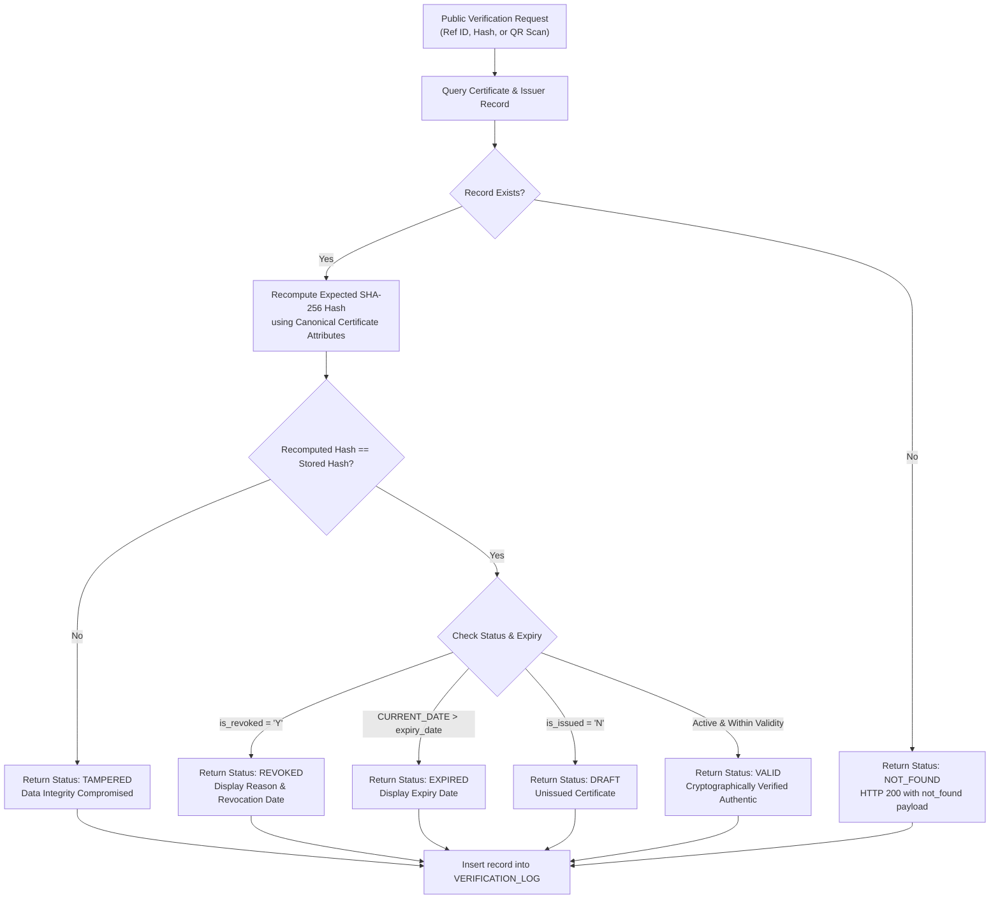

# Digital Certificate Verification System (DCVS)

[](https://www.oracle.com/database/free/)
[](https://www.oracle.com/database/technologies/appdev/rest.html)
[](https://react.dev/)
[](https://vitejs.dev/)
[](https://tailwindcss.com/)
[](#-cryptographic-integrity--verification-engine)

A tamper-proof digital credential issuance, lifecycle management, and cryptographic verification platform backed by **Oracle Database 26ai Free**, **PL/SQL packages**, **Oracle REST Data Services (ORDS)**, and a modern **React 18 + Vite** frontend.

---

## Table of Contents
- [1. Executive Overview](#1-executive-overview)
- [2. System Architecture](#2-system-architecture)
- [3. What Was Done (Implemented Features)](#3-what-was-done-implemented-features)
  - [3.1 Track 3: Administrative Management & Staff Operations (Sriya)](#31-track-3-administrative-management--staff-operations-sriya)
  - [3.2 Track 4: Public Verification Flow & Applicant Portal (Manideep)](#32-track-4-public-verification-flow--applicant-portal-manideep)
  - [3.3 Core Cryptographic & Lifecycle Engine](#33-core-cryptographic--lifecycle-engine)
  - [3.4 Security Hardening & RBAC Enforcement](#34-security-hardening--rbac-enforcement)
- [4. How It Was Done (Technical Walkthrough)](#4-how-it-was-done-technical-walkthrough)
  - [4.1 Database Layer (PL/SQL Stored Logic)](#41-database-layer-plsql-stored-logic)
  - [4.2 REST Gateway Layer (ORDS)](#42-rest-gateway-layer-ords)
  - [4.3 Frontend Engineering (React + Vite)](#43-frontend-engineering-react--vite)
  - [4.4 Cryptographic Verification Algorithm](#44-cryptographic-verification-algorithm)
- [5. Test Login Details & Baseline Accounts Matrix](#5-test-login-details--baseline-accounts-matrix)
- [6. Quick Start & Local Setup Guide](#6-quick-start--local-setup-guide)
  - [6.1 Prerequisites](#61-prerequisites)
  - [6.2 Start Oracle 26ai Database Container](#62-start-oracle-26ai-database-container)
  - [6.3 Initialize Database Schema & Seed Data](#63-initialize-database-schema--seed-data)
  - [6.4 Launch Frontend Development Server](#64-launch-frontend-development-server)
  - [6.5 Production Build](#65-production-build)
- [7. Automated Testing & Quality Assurance](#7-automated-testing--quality-assurance)
- [8. Step-by-Step Guide: Pushing to GitHub](#8-step-by-step-guide-pushing-to-github)
- [9. Project Structure](#9-project-structure)
- [10. Documentation Index](#10-documentation-index)

---

## 1. Executive Overview

Credential forgery, fraudulent academic degrees, and slow manual employee verification workflows pose major security and economic risks. The **Digital Certificate Verification System (DCVS)** solves this by providing:

1. **Tamper-Evident Hashing:** Every certificate is hashed using cryptographic SHA-256 over its immutable properties (title, applicant name, issuer, issue date, unique reference number). Any modification to the certificate data invalidates the hash.
2. **Instant Public Verification:** Anyone can verify certificate authenticity in milliseconds by entering a Reference ID, inputting a hash, or scanning a live QR code with their mobile or web camera.
3. **Single-Tier Enterprise Architecture:** All business logic, cryptographic signing, audit trails, and role-based access controls reside directly inside Oracle Database 26ai Free via PL/SQL packages, exposed as clean REST APIs through Oracle REST Data Services (ORDS).
4. **Zero Intermediate Servers:** Eliminates traditional intermediary Node.js/Express, Django, or Firebase middle tiers, preventing synchronization bugs and reducing attack surface.
5. **Zero Mock Data:** The frontend strictly communicates with live database endpoints.

---

## 2. System Architecture

```
   ┌─────────────────────────────────────────────────────────────┐
   │                  React 18 + Vite Frontend                   │
   │               • Admin & Staff Portal (Track 3)              │
   │               • Public & Applicant Portal (Track 4)         │
   │             Responsive: Desktop, Laptop, Tablet, Mobile     │
   └──────────────────────────────┬──────────────────────────────┘
                                  │ HTTP / JSON (X-Auth-Token)
                                  ▼
   ┌─────────────────────────────────────────────────────────────┐
   │             Oracle REST Data Services (ORDS)                │
   │                     Module: `dcvs.api`                      │
   │             Base URL: http://localhost:8080/ords/dcvs/api   │
   └──────────────────────────────┬──────────────────────────────┘
                                  │ SQL-Net / JDBC
                                  ▼
   ┌─────────────────────────────────────────────────────────────┐
   │                Oracle Database 26ai Free                    │
   │             Pluggable Database: `FREEPDB1`                  │
   │             Schema: `DCVS` (PL/SQL Stored Logic)            │
   │  • Packages: pkg_auth, pkg_certificate, pkg_verification... │
   │  • Tables: account, applicant, certificate, verifier, hr... │
   └─────────────────────────────────────────────────────────────┘
```

---

## 3. What Was Done (Implemented Features)

The project unifies two specialized feature tracks into a single production application:

### 3.1 Track 3: Administrative Management & Staff Operations (Sriya)
- **Interactive KPI Dashboard:** Real-time statistics cards displaying total applicants, active certificates, revocations, and verification counts. Includes visual data charts powered by **Recharts**.
- **Applicant Directory:** Administrative CRUD interface for student/recipient profiles, supporting multi-valued dynamic emails and phone numbers.
- **Certificate Types Registry:** Academic and professional credential catalog management (e.g., Degree Certificate, Internship Certificate, Course Certificate).
- **Accredited Issuers Directory:** Organization profiles, contact records, and accreditation authority management.
- **Certificate Lifecycle Management:** Certificate drafting, editing, official issuance trigger, automated QR code modal, and instant revocation dialog.
- **Revocation Audit Registry:** Historical registry recording exact revocation timestamps and official reasons.
- **Verifier Directory:** Corporate and government verification officer registry linked to Human Resources personnel.
- **Human Resources (HR) Portal:** Employee payroll management (Basic, DA, HRA calculation) and leave balance tracking.
- **Real-Time Verification Logs:** Audit trail capturing every public and authenticated verification attempt, including client IP and timestamp.

### 3.2 Track 4: Public Verification Flow & Applicant Portal (Manideep)
- **Public Landing Page (`/`):** Modern hero section with quick-verify search, live platform statistics, system features, and architectural overview.
- **Instant Certificate Verification Page (`/verify`):** 
  - Verification via Certificate Reference ID (e.g., `DCVS-2026-00001`).
  - Verification via Certificate SHA-256 Hash.
  - Verification via Camera QR Scanner and File Upload QR Scanner (`jsQR`).
  - Full 6-state cryptographic verification result cards (`VALID`, `EXPIRED`, `REVOKED`, `DRAFT`, `TAMPERED`, `NOT_FOUND`).
- **Applicant Self-Service Portal (`/portal`):**
  - Personal dashboard displaying all issued certificates belonging to the logged-in applicant.
  - Status filters (`All`, `Valid`, `Expired`, `Revoked`).
  - Quick QR code modal for mobile scanning and credential sharing.
  - Direct navigation to detailed certificate view.
- **Tamper-Evident Certificate Inspection View (`/portal/certificates/:id`):**
  - High-fidelity digital certificate presentation layout.
  - Complete cryptographic metadata: SHA-256 hash, reference number, digital signature, issuer accreditation details, validity window.
  - Live verification link with QR code.
- **Applicant Profile Management (`/portal/profile`):**
  - Self-service interface for updating residential street address, city, state, pincode.
  - Dynamic multivalued contact arrays (add/edit multiple phone numbers and email addresses).
- **Responsive UI/UX Integration:** Clean Tailwind CSS design system with fluid layout adaptability across Mobile (375px), Tablet (768px), Laptop (1024px), and Desktop (1440px).

### 3.3 Core Cryptographic & Lifecycle Engine
- **Deterministic Canonical Payload:** Certificates are hashed by serializing core fields into a standardized JSON string before running `STANDARD_HASH` (SHA-256).
- **Tamper Detection:** During verification, the system reconstructs the expected hash from the database attributes and compares it to the stored signature hash. Any manual SQL manipulation immediately triggers the `TAMPERED` status.
- **Lifecycle Transition Automation:** Certificates start in `DRAFT` (unissued), transition to `VALID` upon issuance (with reference number and hash generation), automatically reflect `EXPIRED` if current date exceeds `expiry_date`, or switch to `REVOKED` if formally cancelled.

### 3.4 Security Hardening & RBAC Enforcement
- **Salted SHA-256 Passwords:** Passwords hashed with `RAWTOHEX(SYS_GUID())` salt; hashes are never exposed in API responses.
- **Hashed Session Tokens:** Session tokens (`X-Auth-Token`) are SHA-256 hashed before storage in `auth_session`. Database leaks do not expose active tokens.
- **2-Hour Sliding Expiry & Immediate Revocation:** Sessions expire after 2 hours and are wiped instantly from `auth_session` upon logout (`POST /auth/logout`).
- **Object-Level Scoping:** Applicants can strictly view and update only their own profile and certificates (`pkg_applicant.get_scoped`, `pkg_certificate.list_json`). Cross-applicant access is blocked with HTTP 403 / 404.
- **SQL Injection Prevention:** 100% parameter-bound queries via ORDS handlers and PL/SQL packages.

---

## 4. How It Was Done (Technical Walkthrough)

### 4.1 Database Layer (PL/SQL Stored Logic)
The entire database backend was created and modularized into 9 sequential SQL scripts located in [`DCVS_Updated_SQL_9_Files/`](file:///home/harshil/Projects/digital-certificate-verification/DCVS_Updated_SQL_9_Files):

1. **`01_entities.sql`**: Defines core entities (`account`, `applicant`, `issuer`, `certificate_type`, `certificate`, `revocation`, `hr`, `verifier`, `verification_log`, `app_config`, `auth_session`).
2. **`02_relationships.sql`**: Establishes foreign key constraints with referential integrity rules.
3. **`03_multivalued.sql`**: Creates auxiliary 1-to-many tables for multivalued contact attributes (`applicant_email`, `applicant_phone`, `verifier_email`, `verifier_phone`).
4. **`04_views.sql`**: Defines analytical and presentation views (`v_certificate_detail`, `v_applicant_list`, `v_verifier_list`).
5. **`05_packages.sql`**: Implements 10 specialized PL/SQL packages encapsulating business operations:
   - `pkg_auth`: User authentication, session management, and RBAC authorization guards.
   - `pkg_api`: Shared utilities (SHA-256 hashing, JSON helpers, exception formatters).
   - `pkg_applicant`: Applicant profile lifecycle and multivalued contact management.
   - `pkg_certificate`: Certificate generation, SHA-256 hash signing, issuance, and list scoping.
   - `pkg_issuer`: Accredited issuing authority operations.
   - `pkg_cert_type`: Credential category registry.
   - `pkg_verifier`: Verification officer onboarding and credential inspection auditing.
   - `pkg_hr`: Personnel compensation calculation and leave balances.
   - `pkg_revocation`: Formal certificate invalidation with mandatory audit reasons.
   - `pkg_verification`: Public verification verification query, tamper detection, and logging.
6. **`06_triggers.sql`**: Implements database triggers enforcing business constraints (e.g., prohibiting modifications to issued certificates).
7. **`07_seed_data.sql`**: Seeds baseline administrative accounts, sample institutions, verifiers, applicants, and certificates spanning all 4 lifecycle states.
8. **`08_tests.sql`**: Automated PL/SQL verification suite testing stored procedure execution.
9. **`09_ords_modules.sql`**: Defines REST endpoints, templates, and parameter mappings inside Oracle REST Data Services.

### 4.2 REST Gateway Layer (ORDS)
Oracle REST Data Services maps incoming HTTP requests directly to PL/SQL blocks:
- **Base Endpoint:** `http://localhost:8080/ords/dcvs/api`
- **Authentication Header:** `X-Auth-Token`
- **Request & Response Format:** Pure JSON (`application/json`)
- **Error Handling:** Standardized HTTP response codes:
  - `200 OK` / `201 Created` for successful operations.
  - `400 Bad Request` on invalid payloads or validation errors.
  - `401 Unauthorized` for missing or invalid session tokens.
  - `403 Forbidden` for role violations or cross-tenant object access attempts.
  - `404 Not Found` for nonexistent entities or inaccessible certificates.

### 4.3 Frontend Engineering (React + Vite)
- **Framework & Tooling:** React 18, Vite 5, React Router 6, Lucide React icons.
- **Styling Architecture:** A hybrid system combining Sriya's semantic styling (`src/styles.css`) for administrative tables and forms with Manideep's responsive Tailwind CSS (`src/tailwind.css`) for public and applicant portals.
- **Session Management (`AuthContext.jsx`):**
  - Session tokens stored safely in `sessionStorage` (isolated to browser tab).
  - Background session validation against `GET /auth/me` on initial mount with automatic cleanup on expiration.
  - Route guards (`<Guard roles={['admin', 'hr', ...]} />`) guarding unauthorized route access on client side.
- **API Service Layer (`api.js`):**
  - Centralized HTTP client wrapping `fetch`.
  - Automatically attaches `X-Auth-Token` from active session.
  - Automatically intercepts `401 Unauthorized` responses to clear invalid tokens and redirect to login.

### 4.4 Cryptographic Verification Algorithm


---

## 5. Test Login Details & Baseline Accounts Matrix

The database is pre-seeded with test accounts representing every system role and credential state.

| Role | Username | Password | Default Redirect | Primary Permissions & Test Scenarios |
| :--- | :--- | :--- | :--- | :--- |
| **ADMIN** | `admin` | `Admin@1234` | `/admin` | **Full Administrative Privileges:**<br>• Access to KPI Dashboard & analytics charts.<br>• Full CRUD across Applicants, Issuers, Certificate Types.<br>• Issue new certificates & trigger immediate revocations.<br>• Manage Verifier directory and view complete audit logs. |
| **HR (Human Resources)** | `hr1` | `Hr@12345` | `/admin/hr` | **Staff Management & Verifiers:**<br>• User: *Meera HR* (Salary: ₹50k Basic, ₹10k DA, ₹15k HRA).<br>• Manage verifier onboarding and directory (`/admin/verifiers`).<br>• Manage compensation packages and employee leave days. |
| **VERIFIER** | `verifier1` | `Verifier@123` | `/admin/verifications` | **Official Verification Officer:**<br>• User: *Ravi Kumar* (*Sample Tech Pvt Ltd*).<br>• Perform authenticated verifications.<br>• View live real-time verification audit logs (`/admin/verifications`). |
| **APPLICANT 1** | `asha` | `Applicant@123` | `/portal` | **Multi-Certificate Applicant (*Asha M Nair*):**<br>• **Valid Certificate:** *B.Tech Degree Certificate* (Example University).<br>• **Expired Certificate:** *Summer Internship 2025* (Sample Tech).<br>• Test self-service profile update (`/portal/profile`).<br>• Test cryptographic detail view & QR generation. |
| **APPLICANT 2** | `kiran` | `Applicant@123` | `/portal` | **Edge-Case Applicant (*Kiran Reddy*):**<br>• **Revoked Certificate:** *Embedded Systems Course* (Reason: *"Issued by mistake - wrong applicant"*).<br>• **Draft Certificate:** *Pending Course Certificate* (unissued; excluded from portal view until issued). |
| **PUBLIC (Anonymous)** | *(None)* | *(None)* | `/` | **Anonymous Public User:**<br>• No credentials required.<br>• Visit `/verify` to test manual verification and QR scanner.<br>• Test reference numbers: `DCVS-2026-00001`, `DCVS-2026-00002`, `DCVS-2026-00003`. |

---

## 6. Quick Start & Local Setup Guide

### 6.1 Prerequisites
- **Node.js**: v18.0.0 or higher
- **npm**: v9.0.0 or higher
- **Container Engine**: Docker or Podman
- **Python**: v3.8+ (for automated security regression suite)

### 6.2 Start Oracle 26ai Database Container
Run the official Oracle Database Free container image:
```bash
# Using Podman
podman run -d --name oracle-db \
  -p 1521:1521 -p 8080:8080 \
  -e ORACLE_PWD=YourPassword123 \
  container-registry.oracle.com/database/free:latest

# Or using Docker
docker run -d --name oracle-db \
  -p 1521:1521 -p 8080:8080 \
  -e ORACLE_PWD=YourPassword123 \
  container-registry.oracle.com/database/free:latest
```

### 6.3 Initialize Database Schema & Seed Data
Execute the 9 SQL scripts in order against the pluggable database `FREEPDB1`:
```bash
podman exec -i oracle-db sqlplus -s / as sysdba << 'EOF'
alter session set container = FREEPDB1;
@DCVS_Updated_SQL_9_Files/01_entities.sql
@DCVS_Updated_SQL_9_Files/02_relationships.sql
@DCVS_Updated_SQL_9_Files/03_multivalued.sql
@DCVS_Updated_SQL_9_Files/04_views.sql
@DCVS_Updated_SQL_9_Files/05_packages.sql
@DCVS_Updated_SQL_9_Files/06_triggers.sql
@DCVS_Updated_SQL_9_Files/07_seed_data.sql
@DCVS_Updated_SQL_9_Files/09_ords_modules.sql
exit;
EOF
```

Verify that ORDS is online:
```bash
curl -i http://localhost:8080/ords/dcvs/api/health
# Expected: {"status":"UP","database":"OK"}
```

### 6.4 Launch Frontend Development Server
```bash
# Navigate to the frontend directory
cd frontend

# Install dependencies
npm install

# Start development server
npm run dev -- --host
```
Open **`http://localhost:5173/`** in your browser to interact with the application.

### 6.5 Production Build
To create an optimized production build:
```bash
cd frontend
npm run build
```
Static deployment assets will be written to `frontend/dist/`.

---

## 7. Automated Testing & Quality Assurance

DCVS includes a multi-tiered automated testing harness:

### 1. API & End-to-End Integration Suite (`scripts/check-api.mjs`)
Validates every ORDS endpoint, role access matrix, certificate issuance, and full lifecycle:
```bash
node scripts/check-api.mjs
```

### 2. Security Hardening Suite (`scratch/test_m6_security.py`)
Executes 45 automated security assertions covering salted password verification, session invalidation, role escalation protection, object-level isolation, and SQL injection prevention:
```bash
python3 scratch/test_m6_security.py
```

### 3. Responsive UI/UX Regression Suite (`frontend/scripts/test_m8_uiux_responsive.mjs`)
Validates 33 interactive UI assertions across 4 distinct viewports (Mobile, Tablet, Laptop, Desktop) using automated headless browser testing:
```bash
cd frontend && node scripts/test_m8_uiux_responsive.mjs
```

---

## 8. Step-by-Step Guide: Pushing to GitHub

Follow either of the two standard methods below to publish this repository to GitHub cleanly.

### Pre-requisite Check: `.gitignore`
Make sure `.gitignore` exists at the root of the project to avoid pushing large folders like `node_modules` or local `.env` files:
```bash
# Verify .gitignore is in place
git status -u
```
*(Only source files, SQL files, docs, and configurations should appear as untracked, never `node_modules/` or `.env`)*.

---

### Method A: Using GitHub CLI (`gh`) (Fastest)

1. **Log in to GitHub CLI:**
   ```bash
   gh auth login
   ```
   *(Select `GitHub.com`, choose your preferred protocol `HTTPS` or `SSH`, and authenticate via web browser or personal access token).*

2. **Stage and commit all project files:**
   ```bash
   git add .
   git commit -m "feat: complete digital certificate verification system with oracle 26ai, ords, and react"
   ```

3. **Create repository and push automatically:**
   ```bash
   # Create a public repository (or change --public to --private)
   gh repo create digital-certificate-verification --public --source=. --remote=origin --push
   ```

---

### Method B: Using GitHub Web UI + Standard Git Commands

1. **Create an empty repository on GitHub:**
   - Go to [github.com/new](https://github.com/new).
   - Enter Repository Name: `digital-certificate-verification`.
   - Choose **Public** or **Private**.
   - **Do NOT check** "Initialize this repository with a README", ".gitignore", or "License" (we already have them).
   - Click **Create repository**.

2. **Stage and commit your local files:**
   ```bash
   git add .
   git commit -m "feat: initial commit of enterprise digital certificate verification system"
   ```

3. **Rename branch to `main` (if not already):**
   ```bash
   git branch -M main
   ```

4. **Link your remote repository:**
   - **Using HTTPS:**
     ```bash
     git remote add origin https://github.com/<YOUR-USERNAME>/digital-certificate-verification.git
     ```
   - **Or using SSH (recommended if SSH keys configured):**
     ```bash
     git remote add origin git@github.com:<YOUR-USERNAME>/digital-certificate-verification.git
     ```

5. **Push to GitHub:**
   ```bash
   git push -u origin main
   ```
   *(If prompted for password with HTTPS, provide your [GitHub Personal Access Token](https://github.com/settings/tokens)).*

---

## 9. Project Structure

```
digital-certificate-verification/
├── .env.example                     # Environment template for frontend & test scripts
├── .gitignore                       # Production gitignore rules (excludes node_modules, .env)
├── README.md                        # Master project documentation
├── API_CONTRACT.md                  # Comprehensive REST API contract specification
├── DCVS_Updated_SQL_9_Files/        # 9 Ordered Oracle Database 26ai PL/SQL scripts
│   ├── 01_entities.sql              # Core table definitions
│   ├── 02_relationships.sql         # Referential integrity & foreign keys
│   ├── 03_multivalued.sql           # Contact array tables (phone/email)
│   ├── 04_views.sql                 # Data views
│   ├── 05_packages.sql              # PL/SQL business logic packages
│   ├── 06_triggers.sql              # Database triggers
│   ├── 07_seed_data.sql             # Test users & initial demo certificates
│   ├── 08_tests.sql                 # Database test suite
│   └── 09_ords_modules.sql          # ORDS REST endpoint definitions
├── docs/                            # In-depth architectural & audit documentation
│   ├── API_CONTRACT.md              # REST API parameters & response schema
│   ├── DEPLOYMENT.md                # Full deployment guide
│   ├── SECURITY_AUDIT.md            # Security report (45/45 assertions passed)
│   ├── TESTING.md                   # Complete test execution guide
│   ├── UI_UX_AUDIT.md               # Viewport responsiveness audit
│   └── TEAM_CONTRIBUTIONS.md        # Track 3 (Sriya) & Track 4 (Manideep) attribution
├── frontend/                        # React 18 + Vite frontend application
│   ├── src/
│   │   ├── components/              # Shared UI components (Modals, Badges, QR Scanner)
│   │   ├── context/                 # AuthContext (session validation, RBAC)
│   │   ├── layouts/                 # Admin Layout (Sriya) & Main Layout (Manideep)
│   │   ├── pages/
│   │   │   ├── admin/               # Administrative & staff pages
│   │   │   ├── applicant/           # Applicant portal (Dashboard, Detail, Profile)
│   │   │   ├── hr/                  # HR management
│   │   │   ├── public/              # Landing page, Verify page, Login
│   │   │   └── verifier/            # Verification officer pages
│   │   ├── services/api.js          # ORDS API client with token injection
│   │   ├── styles.css               # Semantic CSS design system (Track 3)
│   │   └── tailwind.css             # Tailwind CSS design system (Track 4)
│   └── package.json
└── scripts/
    └── check-api.mjs                # Automated end-to-end API test suite
```

---

## 10. Documentation Index

For in-depth technical references, consult the dedicated documentation in [`docs/`](file:///home/harshil/Projects/digital-certificate-verification/docs):
- **[API Contract Specification](file:///home/harshil/Projects/digital-certificate-verification/docs/API_CONTRACT.md)**: Detailed schema of all 24 REST endpoints.
- **[Production Deployment Guide](file:///home/harshil/Projects/digital-certificate-verification/docs/DEPLOYMENT.md)**: Container setup, production builds, and proxying.
- **[Security Audit & Hardening Report](file:///home/harshil/Projects/digital-certificate-verification/docs/SECURITY_AUDIT.md)**: In-depth audit results.
- **[Testing & Verification Guide](file:///home/harshil/Projects/digital-certificate-verification/docs/TESTING.md)**: Instructions for running all test suites.
- **[UI/UX & Responsiveness Audit](file:///home/harshil/Projects/digital-certificate-verification/docs/UI_UX_AUDIT.md)**: Cross-device testing report.
- **[Team Attribution & Code Preservation](file:///home/harshil/Projects/digital-certificate-verification/docs/TEAM_CONTRIBUTIONS.md)**: Detailed breakdown of contributions by Sriya and Manideep.
